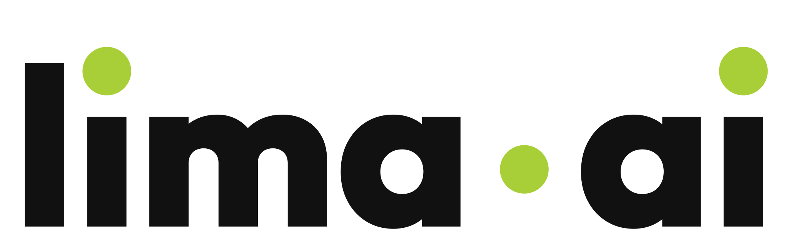

<picture>
  <source media="(prefers-color-scheme: dark)" srcset="https://raw.githubusercontent.com/joepreludian/lima-ai/main/docs/images/logo-dark.svg">
  
</picture>

https://lima-ai.readthedocs.io/

Run several Claude Code agents in parallel on a Mac, each in its own
disposable Linux VM, each working on one workspace of your project: a
branch, an experiment, a review.

REMARK: This project uses Lima Vms. This project isn't associated to Lima itself.

```
lima-ai new preludian/myapp feat-login     →  lima-dev-myapp-feat-login.local
lima-ai new preludian/myapp feat-billing   →  lima-dev-myapp-feat-billing.local
```

Every VM gets its own copy of the project, its own Docker daemon and its own
network address. The same `docker compose` app can run on the same port in
every VM at once, and you open each one by name from your Mac's browser.
Inside a VM the agent has full control: root, Docker, and `claude
--dangerously-skip-permissions` with no permission prompts. It still cannot
write to your Mac's files, except for one backup folder.

## How it works

`lima-ai base` builds one golden Ubuntu VM with Docker, Node, Rust, Claude
Code and the AWS CLI, then seals it. Anything else you want in every VM goes in a
hook script that `lima-ai base --use-hook` runs during the build. `lima-ai new` clones that base in
seconds, copies in your project, your Claude config, your git config and, if
you say yes, your AWS config, and gives the clone its own IP and mDNS name. Nothing is shared with your Mac except a read-only
mount of `~/Developer` and one read-write backups folder, and no VM port is
forwarded to your Mac's `localhost`.

## Documentation

The manual is at **https://lima-ai.readthedocs.io/**:

- [Introduction](https://lima-ai.readthedocs.io/): how it works, with diagrams, and what an agent in a VM can and cannot do
- [Installation](https://lima-ai.readthedocs.io/install/): requirements and install methods
- [Quickstart](https://lima-ai.readthedocs.io/quickstart/): two workspaces of one project, side by side
- [Everyday tasks](https://lima-ai.readthedocs.io/everyday/): syncing, pausing, and what is copied into a VM
- [Docker backups](https://lima-ai.readthedocs.io/docker-backups/): the shared folder, and docker-backup from inside a VM
- [Command reference](https://lima-ai.readthedocs.io/commands/): every command and flag, and how VMs are named
- [Configuration](https://lima-ai.readthedocs.io/configuration/): `config.toml` and the files lima-ai keeps on your Mac
- [Troubleshooting](https://lima-ai.readthedocs.io/troubleshooting/)

## Requirements

- macOS on Apple Silicon
- [Lima](https://lima-vm.io) 2.0 or later: `brew install lima`
- Rosetta, for running `linux/amd64` images:
  `softwareupdate --install-rosetta --agree-to-license`
- Claude Code on the Mac, signed in with a Claude subscription (any plan)
- Optional: an SSH key loaded in `ssh-agent`, to `git push` from inside a VM
- [uv](https://docs.astral.sh/uv/), to install lima-ai from PyPI or from source
  (not needed with Homebrew)
- Optional: [docker-backup](https://docker-backup.readthedocs.io) 0.4.0 or
  later, to restore VM backups into the Mac's Colima:
  `brew install joepreludian/tap/docker-backup`

## Installation

From PyPI (recommended):

```bash
uv tool install lima-ai      # or: pipx install lima-ai
```

With Homebrew (installs Lima too):

```bash
brew install joepreludian/tap/lima-ai
```

Or download a self-contained executable (macOS Apple Silicon, Linux x86_64 or
Linux arm64) from [GitHub Releases](https://github.com/joepreludian/lima-ai/releases)
(the macOS one is unsigned; see the manual for the Gatekeeper step), or install from a checkout
with `uv tool install .` or `make pex`. The
[Installation](https://lima-ai.readthedocs.io/install/) page covers
all of these.

Then, in order:

```bash
lima-ai doctor                           # what is still missing, with the fix for each
ssh-add -l || ssh-add ~/.ssh/id_ed25519  # optional: only to git push from inside a VM
lima-ai auth                             # once: store a Claude token
lima-ai base                             # once: build dev-base (5-10 minutes)
lima-ai new preludian/myapp feat-login   # a workspace VM, then lima-ai shell to get in
```

The [Quickstart](https://lima-ai.readthedocs.io/quickstart/) walks through
these with two workspaces side by side. Upgrading from 0.12 or earlier? Run
`lima-ai base --rebuild`: VMs now mount the backups folder at `/backups` and
ship the AWS CLI.

## Development

```bash
make test        # unit tests; no VM or Lima install needed
make test-lima   # end-to-end tests with real VMs (a few minutes; longer if dev-base must be built)
make lint        # ruff check and format check
make pex         # dist/lima-ai, a self-contained executable for this machine's platform
```

`make test-lima` builds `dev-base` if it is missing, creates
`dev-limaaitest-*` VMs from a small compose project, and deletes them when
it finishes. A `dev-base` built by lima-ai 0.11 or earlier fails the first test
with a message asking for `lima-ai base --rebuild`, since VMs now mount the
backups folder at `/backups`.
