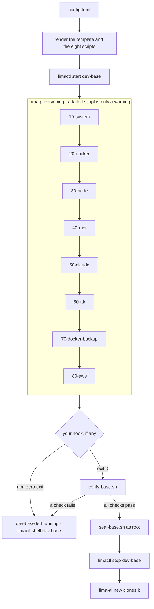
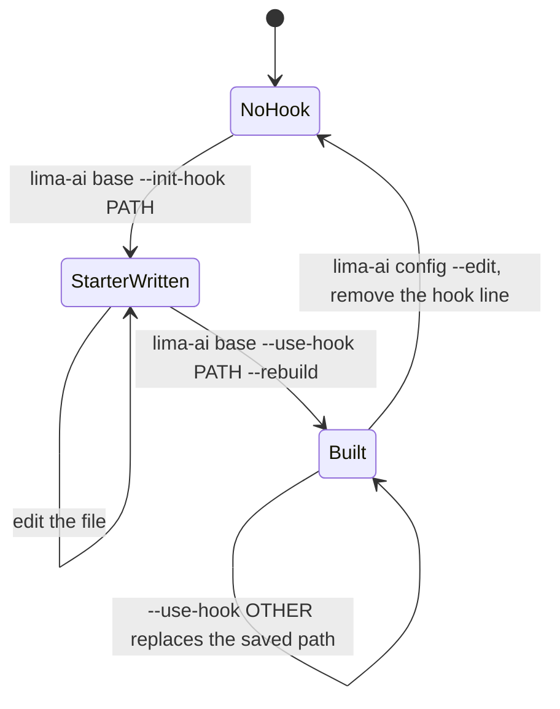
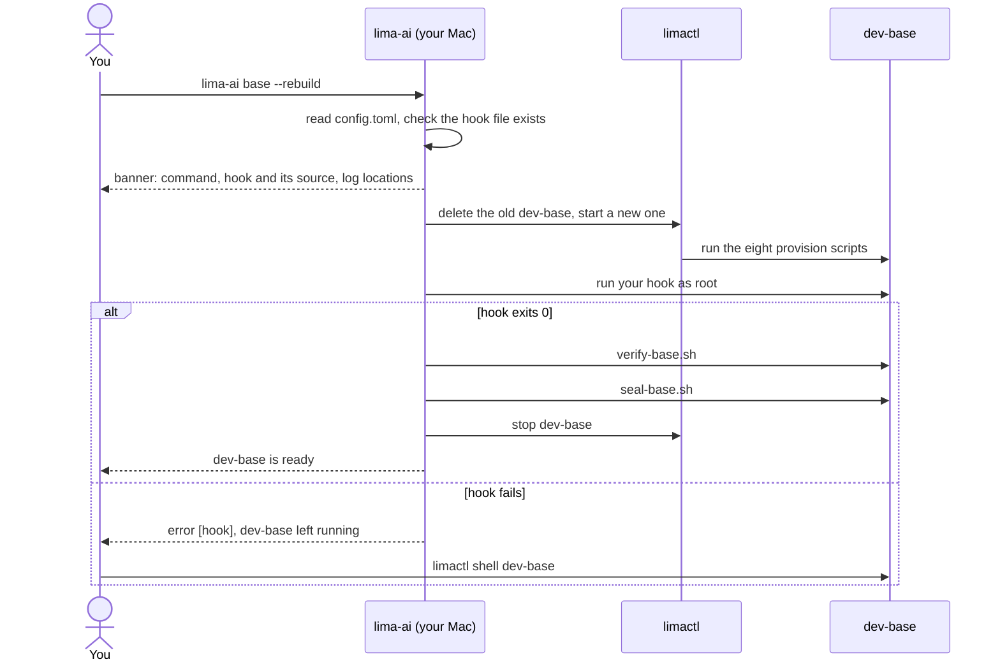

# The base image

Every workspace VM is a clone of one golden VM, `dev-base`. This page
explains how that VM is built, where your own additions go, and how to
manage them.

## What dev-base is

`lima-ai base` builds a single Ubuntu VM, installs the toolchain into it,
checks that everything works, seals it and stops it. `lima-ai new` then
clones it with `limactl clone`, which takes seconds. The minutes of
provisioning happen once, and every workspace starts from the same image.

Sealing is what makes clones distinct: the machine-id and the SSH host keys
are wiped and regenerated on first boot, so each clone gets its own DHCP
lease, its own mDNS name and its own host identity.

## How a build works

The build is driven by two things: the Lima template, rendered from your
`config.toml` (`[vm]` sizes, the mounts, the Ubuntu release), and eight
provision scripts that Lima runs inside the VM in order. Both are written to
`~/.local/state/lima-ai/base/` before every build and overwritten by the
next one, so editing them there is pointless.

| Script | Runs as | Installs |
|---|---|---|
| `10-system.sh` | root | build tools, git, rsync, jq, tmux, ripgrep, fzf, lazygit; avahi for `<name>.local` |
| `20-docker.sh` | root | Docker Engine with the compose and buildx plugins; adds the login user to `docker` |
| `30-node.sh` | login user | Node through fnm, corepack enabled |
| `40-rust.sh` | login user | Rust stable through rustup, with clippy and rustfmt |
| `50-claude.sh` | login user | Claude Code and the shell setup every VM shares |
| `60-rtk.sh` | login user | rtk, pinned and checksum verified |
| `70-docker-backup.sh` | root | docker-backup, pinned and checksum verified |
| `80-aws.sh` | root | AWS CLI v2 and the Session Manager plugin, pinned and checksum verified |

After Lima reports the VM started, lima-ai takes over: it runs your hook if
you have one, runs `verify-base.sh` (one check per tool), runs
`seal-base.sh` as root, and stops the VM.



Two details matter for the hook. Lima treats a failed provision script as a
warning and still reports the VM as started; that is why `verify-base.sh`
exists. Your hook does not go through Lima: lima-ai runs it itself, so a
non-zero exit fails the build immediately, and the VM is left running for
you to inspect.

## The hook file

A hook is one bash script that you own, kept anywhere you like (a dotfiles
repository is a good place, since `config.toml` stores only its path). The
starter that `lima-ai base --init-hook PATH` writes has this structure, top
to bottom:

1. A header comment saying what the file is and how to build with it.
2. `set -euo pipefail` and `export DEBIAN_FRONTEND=noninteractive`, active.
3. Your install commands: `apt-get install`, downloads, anything root can do.
4. Installs that belong to the login user, through
   `sudo -u "$SUDO_USER" -i bash -c '...'`.
5. A self-check at the end, such as `java -version`.
6. A comment block on what to do when it goes wrong.

The contract the hook runs under:

| | |
|---|---|
| Interpreter | `bash`, as **root**, non-interactive |
| `$SUDO_USER` | the login user: the one workspace VMs log in as, owner of `~/.local/share/fnm`, `~/.cargo` and Claude Code |
| `$HOME` | `/root`; the working directory is the login user's home |
| Network | available |
| Exit code | non-zero fails the build and leaves `dev-base` running |
| When | after all eight built-in scripts, before `verify-base.sh` |
| Verified | nothing it installs is checked unless the hook checks it |

What belongs in a hook: packages, SDKs and libraries every workspace needs,
such as a JDK, a database client or a language runtime lima-ai does not
ship. What does not: per-project setup (that is the project's own job once
it is synced in), secrets (nothing in the image should be secret, every
clone carries it), and anything `lima-ai new` already copies per VM, such
as your Claude token, git config or AWS session.

## Managing a hook

The whole lifecycle is four commands:

```bash
lima-ai base --init-hook ~/lima/custom.sh      # write the starter
$EDITOR ~/lima/custom.sh                        # uncomment and edit
lima-ai base --use-hook ~/lima/custom.sh --rebuild   # build with it, remember it
lima-ai base --rebuild                          # later rebuilds use it again
```

`--use-hook` saves the absolute path under `[base] hook` in
`~/.config/lima-ai/config.toml`. From then on every `lima-ai base --rebuild`
uses it, `lima-ai config` shows it, and `lima-ai config --edit` is where you
remove the line to build without it. Passing `--use-hook` with another path
replaces the saved one.



Before anything is deleted or created, the build prints a banner naming the
command, the hook it will use and where it came from (`--use-hook` or
`config.toml`), where Lima's own logs are, and how to get into the VM if a
step fails. This is what one rebuild with a saved hook looks like:



## When the hook fails

1. Read the terminal. The hook's output streamed there, and the error line
   names the file and the exit code.
2. The VM is still running. `limactl shell dev-base`, become root with
   `sudo -i`, and run the failing command by hand.
3. Lima's own logs are in `~/.lima/dev-base/` (`serialv.log` for the guest
   console, `ha.stderr.log` for the host side). They matter when the failure
   is in Lima's provisioning rather than in your hook.
4. Fix the file and run `lima-ai base --rebuild`.
5. To build without the hook for now, remove the `hook` line with
   `lima-ai config --edit`.

## A complete example: Java

Write the starter, then replace its package section with:

```bash
apt-get update
apt-get install -y openjdk-21-jdk-headless
echo 'export JAVA_HOME=/usr/lib/jvm/java-21-openjdk-arm64' > /etc/profile.d/java.sh
```

and uncomment the self-check at the end:

```bash
java -version
```

Build with it and try a workspace:

```bash
lima-ai base --use-hook ~/lima/custom.sh --rebuild
lima-ai new preludian/myapp feat-java
```

Inside the new VM, `java -version` prints the OpenJDK 21 banner, and every
VM you create from now on has it too.
