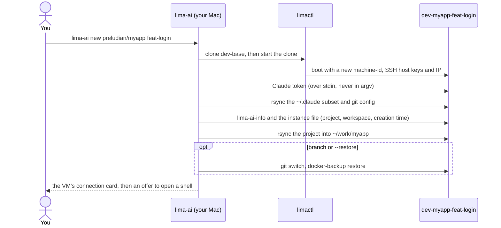
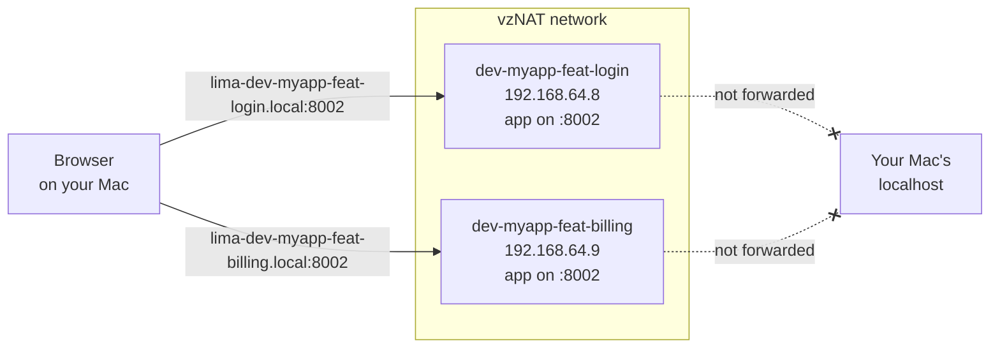
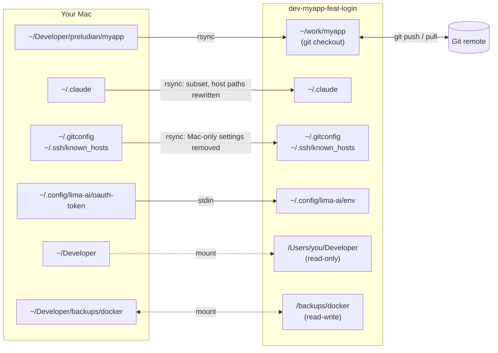

# Introduction

Run several Claude Code agents in parallel on a Mac, each in its own
disposable Linux VM, each working on one workspace of your project: a
branch, an experiment, a review.

```
lima-ai new preludian/myapp feat-login     →  lima-dev-myapp-feat-login.local
lima-ai new preludian/myapp feat-billing   →  lima-dev-myapp-feat-billing.local
```

Every VM gets its own copy of the project, its own Docker daemon and its own
network address. The same `docker compose` app can run on the same port in
every VM at once, and you open each one by name from your Mac's browser.
Inside a VM the agent has full control: root, Docker, and `claude
--dangerously-skip-permissions` with no permission prompts. It still cannot
write to your Mac's files, except for one backup folder.

## How it works

### A golden base, cloned per workspace

`lima-ai base` builds one Ubuntu VM, `dev-base`, with Docker, Node, Rust,
Claude Code, rtk and docker-backup. It checks the toolchain, then seals the
VM: the machine-id and SSH host keys are wiped, so every clone boots with its
own identity. `lima-ai new` clones that base, which takes seconds instead of
a fresh install, and fills the clone:



### Every VM has its own address

Each VM sits on a `vzNAT` network with its own IP and publishes
`lima-<instance>.local` over mDNS (avahi), which your Mac resolves with no
setup. Lima's usual forwarding of guest ports to your Mac's `localhost` is
switched off entirely, so every VM can serve on the same port (say, 8002)
without a clash:



### Copies, not shared folders

The project, your Claude config and your git config are copied into the VM
with rsync, so an agent works on its own files. After that, the working copy
is an ordinary git checkout that pushes to and pulls from your project's own
remotes. Two host folders are mounted as well: `~/Developer` read-only, and
the Docker backups folder read-write.



### What an agent in a VM can and cannot do

| | |
|---|---|
| Root, `sudo`, Docker, install anything | yes, inside its VM |
| Read your projects | yes: `~/Developer` is mounted **read-only** at the same path |
| Write to your Mac's files | only `~/Developer/backups/docker` (mounted at `/backups/docker`) |
| Expose ports on your Mac's `localhost` | no: no VM port is forwarded to your Mac |
| Reach services on your Mac | yes: `host.lima.internal` reaches your Mac's `localhost`, like any Lima VM |
| Use your SSH key | yes, through the forwarded `ssh-agent` while an SSH connection to the VM is open; the key file never enters the VM |
| Use Claude | with a long-lived token from `claude setup-token` (your Max subscription) |

!!! warning
    Anything the agent pushes to a git remote leaves the VM, so review
    branches before you merge them. Services listening on your Mac's
    `localhost` (a local database, say) are reachable from every VM, so
    don't leave anything there that an agent shouldn't touch.

## Next steps

- [Installation](install.md): requirements and how to install lima-ai.
- [Quickstart](quickstart.md): run two workspaces of one project side by side.
